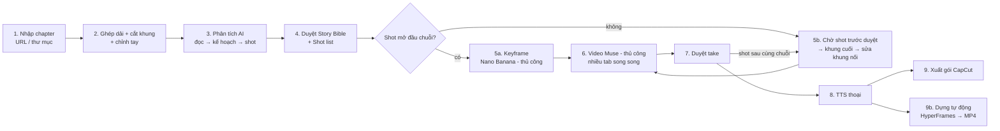
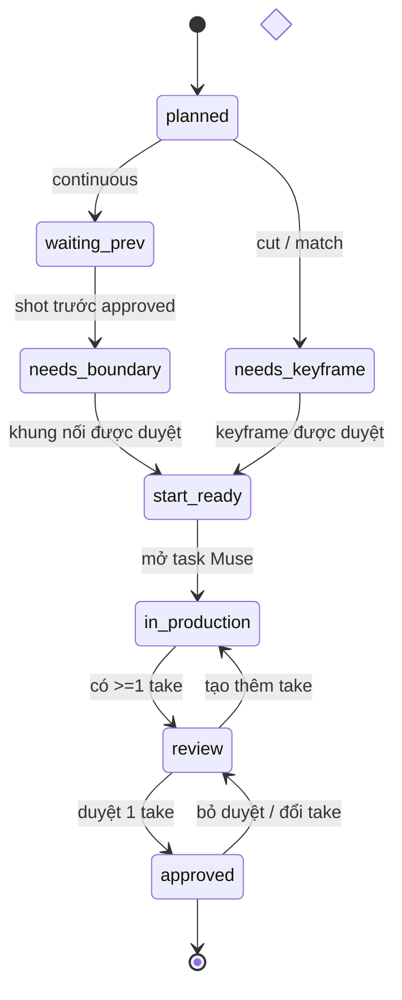

# Comic Film Studio — Đặc tả kỹ thuật (v0.1)

> Tài liệu gốc cho việc triển khai. Antigravity (coder) làm theo tài liệu này; mọi thay đổi hợp đồng dữ liệu
> (schema, API, trạng thái) phải cập nhật lại file này trong cùng PR. Tech lead review: Claude.
> Ngôn ngữ: giao diện người dùng **tiếng Việt**; code, tên biến, API, schema **tiếng Anh**.

---

## 0. Mục tiêu & phạm vi

Một ứng dụng **chạy local trên Windows 11**, mở trên trình duyệt, giúp biến **một chapter truyện tranh**
(manhua/webtoon cuộn dọc là chính) thành **một bộ clip shot ngắn đã duyệt + gói âm thanh/phụ đề**,
để người dùng tự dựng thành phim hoàn chỉnh trong **CapCut**.

### Trong phạm vi (MVP — hoàn thành 1 chapter)
1. Nhập chapter: tải ảnh từ URL (nguồn người dùng được phép truy cập) **hoặc** kéo-thả thư mục ảnh.
2. Ghép tất cả trang thành 1 dải dọc → cắt thành **khung (frame)** → người dùng chỉnh gộp/tách.
3. AI phân tích (Gemini API hoặc **chế độ thủ công**): đọc truyện, phân loại chữ, lập hồ sơ nhân vật/chiêu thức, tạo **shot list** có chia **chuỗi (chain)**.
4. **Bàn giao thủ công** sang Nano Banana (tạo keyframe) và Muse (tạo video): dashboard chuẩn bị sẵn ảnh + prompt, người dùng thao tác trên web của các dịch vụ đó, kéo-thả kết quả về.
5. Lập lịch **lai**: shot thuộc các chuỗi khác nhau làm song song; shot trong cùng chuỗi liên tục làm tuần tự (khung cuối clip trước → ảnh đầu clip sau).
6. Duyệt clip, lưu mọi lần tạo (take), trích khung cuối, sửa khung nối.
7. TTS lời thoại theo giọng từng nhân vật.
8. **Xuất gói CapCut**: clip đánh số thứ tự, file thoại, phụ đề `.srt`, bảng shot `.csv`.
9. Dashboard theo dõi trạng thái toàn bộ.

### Ngoài phạm vi (KHÔNG làm)
- Trình chỉnh timeline kéo-thả trong app (việc dựng tự động làm bằng HyperFrames §8b; chỉnh tinh làm trong CapCut hoặc nhờ AI agent sửa file composition).
- Tự động điều khiển web Muse/Gemini/Nano Banana bằng browser automation.
- Vượt paywall, đăng nhập, captcha, chống bot của web truyện.
- Đa người dùng, cloud, đăng nhập tài khoản.

### Ràng buộc đã xác nhận
| Hạng mục | Thực tế |
|---|---|
| Muse | Chỉ có web. **Chỉ nhận 1 ảnh đầu + prompt**, không có ảnh kết thúc, không API. |
| Nano Banana | Dùng qua app Gemini (thủ công). |
| Phân tích AI | Gemini API qua Google AI Studio key (free tier) — có thể hết hạn mức → cần chế độ thủ công. |
| Gói Gemini Pro / Claude Pro | Không kèm API. |
| Ghép phim | Người dùng tự làm trên CapCut. |
| Máy | Windows 11, không bắt buộc Docker. |

---

## 1. Quy trình tổng thể



| # | Bước | Tự động / Thủ công | Cổng duyệt |
|---|---|---|---|
| 1 | Nhập chapter | tự động (có fallback thủ công) | xem lưới trang, sắp xếp |
| 2 | Cắt khung | tự động + chỉnh tay | **duyệt khung** |
| 3 | Phân tích | API hoặc thủ công | — |
| 4 | Story Bible + Shot list | chỉnh tay trên UI | **duyệt kế hoạch** |
| 5a | Keyframe | thủ công (Nano Banana) | **duyệt keyframe** |
| 5b | Khung nối | tự trích + thủ công sửa (tùy chọn) | **duyệt khung nối** |
| 6 | Video | thủ công (Muse) | — |
| 7 | Duyệt take | người dùng | **duyệt take** |
| 8 | TTS | tự động (API) | nghe thử |
| 9 | Xuất gói CapCut | tự động | kiểm tra thiếu sót |
| 9b | Dựng tự động (HyperFrames) | tự động | xem bản dựng |

---

## 2. Quyết định kiến trúc

**Modular monolith, local-first.** Một tiến trình Python phục vụ cả API lẫn giao diện đã build. Không microservice, không Redis/Celery.

| Lớp | Chọn | Lý do |
|---|---|---|
| Backend | Python 3.12, **FastAPI**, Uvicorn | Hệ sinh thái AI/ảnh tốt nhất; async cho SSE |
| ORM/DB | **SQLModel** (SQLAlchemy 2) + **SQLite (WAL)** + **Alembic** | Một file DB, có migration |
| Hàng đợi job | **In-process async worker** đọc bảng `jobs` | Bền qua restart, không cần dịch vụ ngoài |
| Ảnh | Pillow, numpy (opencv-python-headless nếu cần) | Cắt khung, kiểm tra ảnh |
| Media | **ffmpeg/ffprobe** gọi qua `subprocess` (list args, không shell) | Trích khung, kiểm tra video |
| AI | `google-genai` (Gemini API) sau lớp **provider adapter** | Đổi nhà cung cấp không sửa domain |
| Tải web | `httpx` + `selectolax`; Playwright **tùy chọn** cho trang JS | Nhẹ trước, nặng khi cần |
| Frontend | **React 18 + TypeScript + Vite**, TanStack Query, React Router, Tailwind + shadcn/ui | Chuẩn, dễ cho AI coder |
| Realtime | **SSE** (`EventSource`) | Một chiều server→UI đủ dùng, đơn giản hơn WebSocket |
| Quản lý gói | `uv` (Python), `npm` (frontend) | Nhanh, chạy tốt trên Windows |

Chạy: `uv run cfs` → mở `http://127.0.0.1:8765`. Chỉ bind `127.0.0.1`.

### Phân lớp & chiều phụ thuộc
```
api (routers)  →  services (domain logic)  →  repositories (DB)  
                          ↓                           
                 providers (AI, TTS)   media (ffmpeg, ảnh)   storage (file)
jobs/runner  →  services
```
- `services` **không** import `api`. `providers` **không** biết DB.
- Mọi đường dẫn file lưu trong DB là **tương đối** so với thư mục project.

---

## 3. Mô hình miền

### 3.1 Thực thể

| Thực thể | Trường chính | Ghi chú |
|---|---|---|
| `Project` | id, name, created_at, settings_json | Chứa nhiều chapter, dùng chung nhân vật/chiêu |
| `Chapter` | id, project_id, title, source_url, status | |
| `SourcePage` | id, chapter_id, idx, asset_id, sha256, width, height, status(`ok`/`bad`) | Thứ tự đọc |
| `Frame` | id, chapter_id, idx, asset_id, y0, y1, x0, x1, origin(`auto`/`manual`) | Tọa độ trên dải ghép |
| `Character` | id, project_id, key, name, look_lock, voice_id, ref_asset_ids | Tái dùng qua các chapter |
| `Technique` | id, project_id, key, name, vfx_lock, color_primary, color_secondary | Tái dùng qua các chapter |
| `AnalysisRun` | id, chapter_id, stage(`read`/`plan`/`shots`), mode(`api`/`manual`), provider, model, input_hash, status, raw_output_path, error | Lưu output gốc của AI |
| `Scene` | id, chapter_id, code(`SC01`), order, summary, frame_ids, music_mood | |
| `Chain` | id, chapter_id, code(`C01`), scene_id | Nhóm shot nối liền |
| `Shot` | xem §5.3 | |
| `DialogueLine` | id, shot_id, order, kind, speaker_key, text, at_s, tts_asset_id | |
| `Asset` | xem §5.4 | Mọi file (ảnh, video, audio) |
| `HandoffTask` | xem §5.5 | Việc thủ công trên dịch vụ ngoài |
| `Job` | xem §5.6 | Việc chạy nền |

### 3.2 Loại chuyển cảnh (`transition_in` của shot)
| Giá trị | Ý nghĩa | Ảnh đầu của shot lấy từ | Song song? |
|---|---|---|---|
| `cut` | Cắt cảnh: đổi góc máy/bối cảnh | **Keyframe mới** (Nano Banana) | ✅ |
| `continuous` | Hành động tiếp diễn từ shot trước (cùng chuỗi) | **Khung cuối take đã duyệt của shot trước**, đã sửa | ❌ chờ shot trước |
| `match` | Khớp bố cục/chuyển động với shot trước nhưng là cảnh mới | Keyframe mới, prompt tham chiếu khung cuối shot trước | ✅ (chỉ cần khung cuối nếu có, không bắt buộc) |

Quy tắc: shot đầu tiên của mỗi `Chain` luôn là `cut` hoặc `match`. Shot `continuous` phải cùng `chain_id` với shot liền trước.

### 3.3 Máy trạng thái của Shot


- **`stale`** là cờ (`is_stale=true`), không phải trạng thái riêng: khi take đã duyệt của shot N bị đổi, các shot `continuous` phía sau trong chuỗi bị gắn `is_stale` + cảnh báo. **Không xóa** take cũ; người dùng quyết định làm lại hay giữ.
- Trạng thái được **tính lại** từ dữ liệu (asset + task) bằng một hàm thuần `compute_shot_state(shot, ...)`; DB lưu bản cache để truy vấn nhanh. Hàm này phải có unit test đầy đủ.

### 3.4 Lập lịch lai (cốt lõi)

```
ready_tasks(chapter):
  for chain in chapter.chains (song song):
    for shot in chain.shots theo thứ tự:
      if shot.state == approved: continue
      yield task hiện tại của shot (keyframe | boundary_fix | video) nếu status == ready
      break        # trong 1 chuỗi chỉ shot đầu tiên chưa xong mới "sẵn sàng"
```
- **Ngoại lệ**: shot `cut`/`match` ở giữa chuỗi... không tồn tại — gặp `cut` thì bắt đầu chuỗi mới (do bước phân tích + rule bắt buộc).
- Keyframe của **mọi** shot `cut/match` có thể làm trước, song song, ngay sau khi duyệt shot list.
- Giới hạn song song chỉ là gợi ý UI: `settings.max_parallel_muse_tabs` (mặc định 4) — dashboard làm nổi N task đầu.

### 3.5 Khung nối (boundary frame) cho shot `continuous`
1. Take của shot N được duyệt → job `extract_last_frame` (ffmpeg) → asset `boundary_raw`.
2. Tạo `HandoffTask(kind=boundary_fix)` cho shot N+1: gợi ý dùng Nano Banana **sửa mặt/trang phục** theo ảnh chuẩn nhân vật (đính kèm `boundary_raw` + `ref_asset_ids`).
3. Người dùng: (a) thả ảnh đã sửa → `boundary_fixed`, hoặc (b) bấm **"Dùng khung gốc"** (không sửa).
4. Duyệt → shot N+1 `start_ready`.
> Mục đích: Muse hay trôi mặt; sửa ở mỗi mắt xích để lỗi không cộng dồn và **không để khung lỗi lan xuống chuỗi**.

---

## 4. Phân tích AI

### 4.1 Các lượt (không gom một prompt khổng lồ)
| Lượt | Input | Output (JSON) | Lưu | Cổng duyệt |
|---|---|---|---|---|
| `read` | Ảnh khung theo lô 6 + **1 khung trước & 1 khung sau làm ngữ cảnh** + tóm tắt lô trước + danh sách nhân vật/thuật ngữ đã có | `FrameReading[]` (loại khung, câu thoại thô, người nói) + `running_summary` | `analysis/read_*.json` | |
| `dialogue` | **Toàn bộ thoại của chapter** (chỉ chữ, đúng thứ tự đọc) + hồ sơ nhân vật + **thư viện thuật ngữ** + **bảng xưng hô** | câu đã biên tập + đề xuất thuật ngữ/xưng hô mới | `analysis/dialogue.json` | **Duyệt kịch bản thoại** |
| `plan` | Readings + thoại đã duyệt + bible | nhân vật/chiêu mới, `scenes`, `chains` | `analysis/plan.json` | |
| `shots` | Từng scene: readings + ảnh khung + bible + thoại đã duyệt | `ShotDraft[]` | `analysis/shots_SCxx.json` | **Duyệt kế hoạch** |

- Prompt đặt trong `backend/app/providers/prompts/*.md` (có version trong tên file, vd `read.v1.md`).
- Mỗi lượt: validate bằng Pydantic → lỗi thì gửi lại thông báo lỗi cho model (tối đa 3 lần) → vẫn lỗi thì `AnalysisRun.status=failed`, **giữ raw output** để người dùng xem/sửa.
- Cache theo `input_hash = sha256(stage, model, prompt_version, inputs)` → chạy lại không tốn quota.

### 4.2 Chế độ thủ công (khi không có/hết API)
Với mỗi lượt, dashboard có nút **"Xuất gói cho Gemini"**: tạo thư mục/zip gồm ảnh cần đính kèm + `prompt.txt` (đã chèn schema & context). Người dùng dán vào app Gemini, copy JSON kết quả, dán vào ô **"Dán kết quả"** → backend validate y hệt chế độ API, báo lỗi theo trường.

### 4.3 Luật bắt buộc áp sau khi AI trả (code, không tin AI)
Port từ prototype `docs/reference/prototype/rules.py`:
1. Chữ loại `technique_name` → `titles` (tên chiêu hiện trên màn hình), **không bao giờ** thành phụ đề thoại.
2. Mọi `dialogue / inner_thought / narration` trong frame của scene phải có mặt trong `DialogueLine` của một shot (bổ sung nếu sót).
3. Chèn nguyên văn `style_lock`, `look_lock` nhân vật có mặt, `vfx_lock` chiêu thức vào `keyframe_prompt` và `video_prompt`.
4. `continuous` chỉ hợp lệ khi cùng chain và cùng scene với shot trước; vi phạm → đổi thành `cut` + ghi chú.
5. Thời lượng shot ≥ thời gian đọc thoại (~14 ký tự/giây) — vượt `settings.muse_clip_seconds` thì cảnh báo "nên tách shot".
6. Ghi mọi chỉnh sửa vào `analysis/rule_notes.json` để hiển thị trên UI.

### 4.5 Kịch bản thoại & thư viện thuật ngữ (Phase 2a)

**Loại khung** (`Frame.frame_type`, AI đề xuất ở lượt `read`, người dùng sửa được):

| `frame_type` | Ví dụ | Đi tiếp |
|---|---|---|
| `scene` | có hình nhân vật/bối cảnh | thành shot (Phase 2b) |
| `dialogue_only` | chỉ bong bóng thoại trên nền trống | **không thành shot**; thoại gắn vào khung `scene` kề bên |
| `caption` | khung dẫn truyện, "3 ngày sau…" | chữ trên màn hình / giọng kể; gắn vào khung kề bên |
| `sfx_only` | chỉ chữ tượng thanh | gắn vào khung kề bên dưới dạng hiệu ứng |
| `credit` | banner nhóm dịch, quảng cáo | **đề xuất bỏ** (người dùng duyệt) |

**Bóc thoại (lượt `read`)** — mỗi câu: nội dung **chép nguyên văn** (`text_raw`), loại, người nói (`speaker_key` nếu là nhân vật đã biết; nhân vật phụ chưa tên → `speaker_label` kiểu "lính gác" + `speaker_gender`, `speaker_age`), **độ tin cậy** người nói (0–1), thứ tự đọc trong khung, và **gắn vào khung nào** (`belongs_to`: `self` | `prev` | `next` → quy ra `anchor_frame_id` là một khung `scene`). AI luôn được xem khung trước/sau để quyết định `prev/next`.

**Biên tập thoại (lượt `dialogue`)** — AI đọc **toàn bộ thoại cả chapter một lượt** rồi viết lại `text`:
- Sửa lỗi dịch máy, câu cứng, sai ngữ pháp; giữ **đúng nghĩa và tình tiết**, không thêm thông tin mới.
- Dùng **đúng thuật ngữ chuẩn** trong thư viện (tên người, địa danh, chiêu thức, cảnh giới, tông môn, vật phẩm, danh xưng).
- Dùng **đúng xưng hô** theo cặp nhân vật (vd. đệ tử ↔ sư phụ: "đệ tử" / "sư phụ"; kẻ thù: "ta" / "ngươi"), nhất quán suốt chapter.
- Văn phong hợp thể loại (tu tiên/võ hiệp: cổ phong vừa phải, không lạm dụng Hán Việt khó hiểu).
- Độ dài lệch không quá ±40% so với bản gốc (để phụ đề kịp đọc); câu đổi nghĩa đáng kể phải kèm `edit_note`.
- Trả thêm: `glossary_candidates` (từ đặc biệt mới + các biến thể sai gặp được) và `address_candidates` (xưng hô mới phát hiện).

**Luật code sau lượt `dialogue`** (không tin AI):
1. Thay mọi **biến thể đã biết** → thuật ngữ chuẩn (đã duyệt) trong `text` (không phân biệt hoa/thường, theo ranh giới từ).
2. Mọi câu thô phải có đúng 1 câu đã biên tập tương ứng (theo `line_id`), không mất câu, không thêm câu.
3. Câu lệch độ dài > 40% hoặc có `edit_note` → gắn cờ để người dùng soát.
4. `technique_name` dùng **đúng tên chuẩn** của chiêu → cũng là chữ hiện trên màn hình (Phase 2b).

**Thư viện thuật ngữ** (project-level, dùng lại mọi chapter): `term` (chuẩn), `kind` (`person | place | technique | realm | sect | item | title | other`), `variants` (cách viết sai đã gặp), `note`, `status` (`suggested | approved | rejected`), `first_seen_chapter_id`. Chỉ thuật ngữ `approved` mới được dùng để thay thế tự động.

**Bảng xưng hô** (project-level): `speaker_key` → `listener_key`: `self_term` (ta, đệ tử, bản tọa…), `address_term` (ngươi, sư phụ, tiền bối…), `status` như trên.

**Chế độ lời thoại** (`Project.settings.dialogue_mode`, đổi được bất kỳ lúc nào, không phải làm lại phân tích/video):

| Giá trị | Người xem nhận được |
|---|---|
| `subtitles` (**mặc định, chapter đầu**) | phụ đề + hiệu ứng âm thanh + nhạc nền |
| `voice` | mỗi nhân vật 1 giọng TTS theo giới tính/tuổi + phụ đề tùy chọn |
| `narration` | 1 giọng kể chuyện + phụ đề |

Thời lượng hiển thị câu (chế độ `subtitles`): `max(1.2s, ký tự / 14)`; shot tự kéo dài cho đủ.

**Hội thoại dài**: khi thoại gắn vào 1 khung `scene` vượt `settings.muse_clip_seconds` × 1.5, lượt `shots` (Phase 2b) **đề xuất chèn shot phản ứng** (cận mặt người nghe / chuyển qua lại giữa người nói), đánh dấu `inserted: true` + cần duyệt; không đề xuất được thì giữ khung lâu hơn.

### 4.4 Đặc thù Muse (chỉ ảnh đầu)
`video_prompt` phải mô tả rõ **trạng thái kết thúc** (`end_state`) — vì không ép được khung cuối, đây là cách duy nhất để shot sau dự đoán được. Khuyến nghị clip ngắn (3–5s) để giảm trôi mặt.

---

## 5. Hợp đồng dữ liệu (schema)

Mọi schema là Pydantic model trong `backend/app/schemas/`, xuất JSON Schema tự động (`/api/schemas/{name}`) để frontend sinh type (`openapi-typescript`). Có trường `schema_version`.

### 5.1 `FrameReading` (output lượt `read`)
```json
{
  "frame_id": "F012",
  "description": "Extreme close-up of the hero, eyes closed, magenta mark on forehead emitting a horizontal beam.",
  "characters": ["hero"],
  "texts": [
    {"kind": "technique_name", "text": "Ma La Lục Thức Thông!", "speaker": null}
  ],
  "intensity": 4,
  "continues_previous": false,
  "technique_hint": "ma_la_luc_thuc_thong",
  "implied_motion": "the mark ignites and spiritual sense shoots outward"
}
```
`texts[].kind` ∈ `dialogue | inner_thought | narration | technique_name | sfx | system`. `intensity` 1–5.

Bổ sung (Phase 2a): `frame_type` (§4.5); mỗi phần tử `texts[]` thêm `line_no` (thứ tự đọc trong khung), `speaker_key | null`, `speaker_label | null`, `speaker_gender` (`male | female | unknown`), `speaker_age` (`child | teen | young_adult | middle_aged | elderly | unknown`), `speaker_confidence` (0–1), `belongs_to` (`self | prev | next`).

### 5.1b `DialogueLine` (bảng `dialogue_lines`)
```json
{
  "id": "DL00123", "chapter_id": "CH01", "order": 57,
  "source_frame_id": "F040", "anchor_frame_id": "F039",
  "kind": "dialogue",
  "speaker_key": "lam_phong", "speaker_label": null,
  "speaker_gender": "male", "speaker_age": "young_adult", "speaker_confidence": 0.62,
  "text_raw": "Khế nguyên linh thạch nhà ta không phải là nên hoàn chỉnh sao? Sao lại vỡ thành như này?",
  "text": "Khối Nguyên Linh Thạch nhà ta vốn nguyên vẹn cơ mà? Sao lại vỡ thành thế này?",
  "edited_by": "ai", "edit_note": null, "needs_review": true,
  "shot_code": null, "at_s": null, "dur_s": null
}
```
`edited_by` ∈ `none | ai | user`. Người dùng sửa tay → `user`, AI chạy lại **không ghi đè** câu `user`.

### 5.1c `GlossaryTerm` / `AddressRule` (project-level)
```json
{"id": "GT0007", "project_id": "PJ01", "term": "Nguyên Linh Thạch", "kind": "item",
 "variants": ["nguyên linh thạch", "Khế nguyên linh thạch"], "note": "đá linh khí dùng tu luyện",
 "status": "approved", "first_seen_chapter_id": "CH01"}
{"id": "AR0003", "project_id": "PJ01", "speaker_key": "lam_phong", "listener_key": "su_phu",
 "self_term": "đệ tử", "address_term": "sư phụ", "status": "approved"}
```

### 5.2 Story Bible (project-level)
```json
{
  "schema_version": 1,
  "style_lock": "2D anime cel-shaded, matching source manhua line art, cinematic lighting",
  "negative": "no text, no speech bubbles, no watermark",
  "characters": [
    {"key": "hero", "name": "Hero", "gender": "male", "age_group": "young_adult",
     "voice_style": "điềm tĩnh, lạnh", "aliases": ["Lâm Phong", "tiểu tử họ Lâm"],
     "look_lock": "young man, long dark brown hair loosely tied, white inner robe, dark outer robe",
     "voice_id": "vi-male-1", "ref_asset_ids": ["A0042"]}
  ],
  "techniques": [
    {"key": "ma_la_luc_thuc_thong", "name": "Ma La Lục Thức Thông",
     "vfx_lock": "magenta star mark ignites on forehead, razor-thin horizontal beam, concentric magenta rings pulse like radar",
     "color_primary": "#D040FF", "color_secondary": "#FFFFFF"}
  ]
}
```

### 5.3 `Shot`
```json
{
  "schema_version": 1,
  "code": "SH014",
  "scene_code": "SC03",
  "chain_code": "C05",
  "chain_pos": 1,
  "order": 14,
  "transition_in": "continuous",
  "frame_ids": ["F012", "F013"],
  "phase": "release",
  "duration_s": 4.0,
  "camera": {"shot_size": "extreme_close_up", "movement": "push_in", "angle": "low"},
  "action": "The mark flares and light floods the screen",
  "emotion": "power unleashed",
  "start_state": "close-up face, mark glowing, eyes closed",
  "end_state": "screen almost fully white-violet with radial speed lines",
  "keyframe_prompt": "…(chỉ dùng khi transition_in là cut/match)…",
  "video_prompt": "…mô tả chuyển động + trạng thái kết thúc…",
  "titles": [{"text": "Ma La Lục Thức Thông!", "style": "technique", "at_s": 1.2, "dur_s": 1.8}],
  "dialogue": [{"kind": "dialogue", "speaker_key": "hero", "text": "Ra đây!", "at_s": 0.3}],
  "sfx_notes": "energy hum rising, whoosh at flash",
  "state": "waiting_prev",
  "is_stale": false,
  "approved_take_id": null
}
```
Enum:
- `transition_in`: `cut | continuous | match`
- `phase`: `establish | dialogue | reaction | anticipation | charge | release | travel | impact | aftermath | transition`
- `state`: `planned | needs_keyframe | waiting_prev | needs_boundary | start_ready | in_production | review | approved`
- `titles[].style`: `technique | sfx | system`
- `dialogue[].kind`: `dialogue | inner_thought | narration | technique_shout`

### 5.4 `Asset`
```json
{
  "id": "A0193", "kind": "take", "path": "chapters/ch001/takes/SH014/take_03.mp4",
  "sha256": "…", "version": 3, "parent_ids": ["A0188"],
  "shot_code": "SH014", "provider": "muse", "prompt_snapshot": "…",
  "created_at": "2026-10-16T08:00:00Z", "approval": "approved", "notes": "mặt giữ tốt",
  "media": {"width": 1280, "height": 720, "duration_s": 5.0, "fps": 24, "has_audio": true}
}
```
`kind`: `page | page_preview | frame | ref | keyframe | boundary_raw | boundary_fixed | take | tts | export`.
`approval`: `pending | approved | rejected`. **Không bao giờ tự xóa** asset đã duyệt hay take cũ.

### 5.5 `HandoffTask` (việc thủ công trên dịch vụ ngoài)
```json
{
  "id": "T0077", "kind": "video", "service": "muse", "shot_code": "SH014",
  "status": "ready",
  "input_asset_ids": ["A0190"],
  "attach_asset_ids": [],
  "prompt": "…",
  "instructions_vi": "Mở Muse → tải ảnh đầu → dán prompt → tạo → tải video về và thả vào đây",
  "result_asset_ids": ["A0191", "A0193"],
  "opened_at": null, "completed_at": null
}
```
- `kind`: `keyframe` (Nano Banana) | `boundary_fix` (Nano Banana) | `video` (Muse) | `analysis_manual` (Gemini app)
- `status`: `blocked | ready | in_progress | submitted | done | cancelled`
- Chỉ chuyển `submitted` khi **file kết quả đã được thả vào, kiểm tra hợp lệ và lưu** — không bao giờ coi "đã copy prompt" là xong.

### 5.6 `Job` (chạy nền)
```json
{
  "id": "J0412", "type": "extract_last_frame", "status": "succeeded",
  "depends_on": ["J0410"], "input_hash": "…", "attempts": 1, "max_attempts": 3,
  "progress": 1.0, "log_path": "jobs/J0412.log",
  "error_category": null, "error_message": null, "user_action_required": null,
  "created_at": "…", "started_at": "…", "finished_at": "…"
}
```
- `status`: `queued | running | waiting_user | succeeded | failed | cancelled`
- `error_category`: `transient` (mạng, 429, timeout → tự retry backoff) | `invalid_output` (JSON sai → retry có phản hồi lỗi) | `permanent` (file hỏng, cấu hình sai) | `quota` (hết hạn mức → gợi ý chế độ thủ công)
- Khởi động lại app: job `running` → `queued` (tiếp tục). Job **idempotent** theo `input_hash`: trùng hash + đã `succeeded` → dùng lại output.
- Retry `transient`: **không** giữ slot khi chờ backoff — đặt `status=queued` + `next_run_at = now + delay` (cột mới); worker chỉ lấy job có `next_run_at <= now`. Hủy trong lúc chờ backoff phải có hiệu lực.
- Phụ thuộc: job có cha `failed`/`cancelled` → giữ `queued` nhưng set `user_action_required` = "Chờ job <id> được sửa/chạy lại" và phát sự kiện; cha chạy lại thành công → tự xóa thông báo. Cha không tồn tại → `failed/permanent`.
- Handler có thể là `async def` **hoặc** `def` (việc nặng CPU/IO: Pillow, numpy, ffmpeg). Handler `def` chạy bằng `asyncio.to_thread`; `report_progress`, `log`, phát sự kiện phải **thread-safe** (event bus dùng loop chính + `call_soon_threadsafe`).
- Payload chỉ chứa ID và tham số kỹ thuật, **không bao giờ** chứa secret.
- Loại job MVP: `import_url`, `import_local`, `stitch_and_cut`, `analysis_read`, `analysis_plan`, `analysis_shots`, `probe_media`, `extract_last_frame`, `tts_line`, `export_capcut`.

---

## 6. Nhập chapter

### 6.1 Từ URL
- `SiteProfile` (file `backend/app/importer/profiles/*.yaml`): `domain`, `image_selector` (CSS), `image_attr` (`src`/`data-src`/`data-original`), `referer` (bool), `min_width`.
- Không có profile → chiến lược chung: lấy mọi `` trong trang theo thứ tự DOM, lọc ảnh nhỏ (< 300px rộng), lọc logo/quảng cáo theo tỷ lệ + kích thước.
- Tải tối đa 3 song song, retry 3 lần (backoff), header `Referer` là trang chapter, `User-Agent` trung thực (`ComicFilmStudio/0.1`).
- Kiểm tra từng ảnh bằng Pillow (`verify`), chống trùng bằng sha256, cảnh báo nếu trang trống/thiếu số thứ tự.
- **Chặn**: URL không phải http/https, IP nội bộ/localhost (chống SSRF), phản hồi > 30MB/ảnh. Gặp 401/403/captcha → dừng, báo người dùng dùng nhập thư mục. **Không** cố vượt.
- Playwright (trang tải ảnh bằng JS): tùy chọn, bật trong Settings, làm ở Phase 1b nếu cần.

### 6.2 Từ thư mục/ảnh
Kéo-thả nhiều ảnh hoặc chọn thư mục. Sắp xếp theo **tên tự nhiên** (`1, 2, 10`), cho phép kéo đổi thứ tự.

### 6.3 Ghép & cắt khung
- **Dải ảo** (không ghi 1 file ảnh khổng lồ — JPEG giới hạn 65 535px): mỗi trang được scale về cùng chiều rộng `W` (= `Chapter.strip_width`) và xếp chồng; trang có `y_offset` trên dải. Khung là khoảng `[y0, y1)` trên dải, được cắt bằng cách ghép các trang chồng lấn khoảng đó. UI hiển thị dải bằng các ảnh preview rộng 400px của từng trang xếp chồng.
- Phát hiện gutter tính theo **từng hàng** nên làm theo từng trang rồi nối mask → khung vắt qua 2 trang tự liền lại.
- Cắt tự động theo dải nền đồng màu (gutter): thuật toán trong `docs/reference/prototype/panels.py` (`split_image`, `_gutter_mask`, `_runs`, `_merge_close`). Đoạn vẽ liền > 2400px → chia nhỏ.
- Mảnh quá thấp (< 160px, thường là dải chữ) → gộp vào mảnh kế.
- **UI chỉnh tay** (bắt buộc, vì cắt tự động không hoàn hảo): xem dải dọc với các đường cắt; bấm giữa 2 khung để **gộp**; bấm vào 1 khung để **thêm đường cắt**; kéo đường cắt để chỉnh.
- AI gom mảnh (prototype `_ai_groups`) là **tùy chọn**, làm sau Phase 2.

---

## 7. Dashboard

Bố cục chung: **thanh bên trái** (Dự án → Chapter → các bước), **vùng chính**, **thanh trạng thái** dưới (job đang chạy, task chờ người dùng). Nền tối trung tính, preview ảnh/video lớn.

| Màn hình | Mục đích | Thành phần chính |
|---|---|---|
| **Dự án** | Danh sách project/chapter, tiến độ | Thẻ chapter: % shot đã duyệt, dung lượng |
| **Nhập chapter** | URL/thư mục → lưới trang | Ô URL, vùng thả ảnh, lưới thumbnail kéo đổi thứ tự, cảnh báo trùng/hỏng |
| **Khung** | Duyệt cắt khung | Dải dọc + đường cắt, gộp/tách, nút "Duyệt khung" |
| **Kịch bản** | Story Bible + scene + shot list | Tab Nhân vật / Chiêu thức / Scene; bảng shot chỉnh được; hiển thị `rule_notes` |
| **Bảng shot** | Nhìn toàn cục theo chuỗi | **Mỗi chuỗi một hàng (lane)**, thẻ shot theo thứ tự, màu theo trạng thái, mũi tên `continuous` |
| **Hàng chờ** ⭐ | Nơi làm việc chính | Danh sách task `ready` (song song), mỗi thẻ: ảnh cần tải lên (nút tải/kéo ra), prompt + nút Copy, hướng dẫn, **vùng thả kết quả** |
| **Chi tiết shot** | So sánh take, duyệt | Ảnh đầu, các take (video), so khung cuối, Duyệt/Từ chối, ghi chú |
| **Nhân vật** | Ảnh chuẩn, giọng | Chọn ảnh chuẩn từ keyframe/take đã duyệt (cắt vùng mặt), gán giọng TTS, nghe thử |
| **Thoại** | Danh sách câu thoại, TTS | Bảng câu thoại theo shot, tạo/tạo lại TTS, nghe |
| **Xuất** | Gói CapCut | Danh sách thiếu (shot chưa duyệt, thoại chưa TTS), nút Xuất, mở thư mục |
| **Job** | Theo dõi việc nền | Lọc theo trạng thái, log, Retry/Hủy, phụ thuộc |
| **Cài đặt** | API key, thư mục dữ liệu | Trạng thái kết nối provider (không hiện key), test kết nối |

Mỗi màn hình phải có trạng thái **trống / đang tải / lỗi** rõ ràng, thông điệp tiếng Việt kèm cách khắc phục.

### Hàng chờ — chi tiết (màn hình quan trọng nhất)
- Mặc định lọc `ready`, sắp theo thứ tự shot; N thẻ đầu (N = `max_parallel_muse_tabs`) được làm nổi.
- Nút **"Mở Muse"/"Mở Gemini"** mở URL dịch vụ trong tab mới (URL cấu hình trong Settings).
- **Kéo ảnh từ thẻ ra** (HTML5 drag, `DownloadURL`) hoặc nút "Tải ảnh" để upload lên Muse nhanh.
- **Vùng thả kết quả** nhận nhiều file; backend kiểm tra (ảnh: Pillow; video: ffprobe có luồng video, thời lượng > 0) → tạo asset → task `submitted`.
- Tùy chọn **thư mục theo dõi** (watch `Downloads`): file mới có tên chứa mã shot (`SH014`) tự gắn vào task — Phase 5.

---

## 8. Xuất gói CapCut

```
exports/<chapter>_<yyyyMMdd-HHmm>/
  video/001_SH001_C01.mp4        ← take đã duyệt, giữ nguyên chất lượng (copy, không encode lại)
  video/002_SH002_C01.mp4
  audio/001_SH001_L1_hero.wav    ← TTS từng câu thoại
  subtitles.srt                  ← thoại, thời gian = tổng thời lượng thật các take trước + at_s
  titles.srt                     ← tên chiêu/chữ tượng thanh (để tự tạo kiểu trong CapCut)
  shot_sheet.csv                 ← order, shot, file, duration, chain, transition, dialogue, titles, sfx_notes, music_mood
  HUONG_DAN.txt                  ← cách nhập vào CapCut
```
- Thời lượng lấy từ ffprobe của take thật, **không** lấy `duration_s` dự kiến.
- Shot chưa duyệt → chặn xuất (hoặc tùy chọn "xuất bản nháp" có đánh dấu `DRAFT_`).

---

## 8b. Dựng tự động bằng HyperFrames

[HyperFrames](https://github.com/heygen-com/hyperframes) (HeyGen, Apache-2.0): video mô tả bằng **HTML** (clip đặt lên timeline bằng
`data-start` / `data-duration` / `data-track-index`, hiệu ứng bằng CSS/GSAP), render ra MP4 bằng Chrome headless + FFmpeg.
Vì composition là HTML thuần, **AI agent (Claude, Gemini, Antigravity) đọc & sửa được** — đây là cách "nhờ AI edit video".

### Luồng
1. Job `build_composition` sinh `exports/<…>/hyperframes/index.html` từ dữ liệu đã duyệt:
   | Track | Nội dung | Nguồn |
   |---|---|---|
   | 0 | Clip video nối tiếp | take đã duyệt (thời lượng thật từ ffprobe) |
   | 1 | Thoại | file TTS, `at_s` của `DialogueLine` |
   | 2 | SFX / nhạc nền (tùy chọn) | thư mục SFX/nhạc người dùng chọn |
   | 3 | Phụ đề | `DialogueLine` |
   | 4 | Tên chiêu / chữ tượng thanh | `Shot.titles` — mẫu animation GSAP theo `style` + màu chiêu (`color_primary`) |
   - Media tham chiếu bằng **đường dẫn tương đối** (copy hoặc hard-link vào thư mục composition).
   - Mẫu HTML/CSS/GSAP để trong `backend/app/assembly/templates/` (có version), không viết cứng trong code Python.
2. Xem trước: mở `index.html` trong trình duyệt (route phục vụ tĩnh của app, chỉ trong `data_dir`).
3. Job `render_composition`: gọi CLI HyperFrames qua `subprocess` (list args, timeout, cwd = thư mục composition) → `final.mp4`; parse tiến độ nếu CLI có in ra.
4. **Sửa bằng AI agent**: người dùng (hoặc agent có HyperFrames skills) sửa `index.html`. App lưu hash lúc sinh; nếu file đã bị sửa tay thì `build_composition` lần sau **không ghi đè**, tạo thư mục phiên bản mới `hyperframes_v2/` và báo.

### Yêu cầu & rủi ro
- Node.js 22+ (máy Bin: v24 ✓), FFmpeg trong PATH, Chrome headless do HyperFrames quản lý.
- README của HyperFrames **không ghi rõ hỗ trợ Windows** → Phase 4 bắt đầu bằng **spike**: render composition 3 clip + 1 title trên Windows. Không chạy được → giữ gói CapCut, HyperFrames chuyển sang chạy trong WSL hoặc để sau.
- Lệnh CLI chính xác (`npx hyperframes render …`) phải lấy từ tài liệu chính thức lúc làm, không đoán.
- Gói CapCut (§8) **vẫn giữ** làm đường dự phòng và để chỉnh tinh.

---

## 9. API (REST, tiền tố `/api`)

| Method | Route | Mục đích |
|---|---|---|
| GET/POST | `/projects` | Liệt kê / tạo project |
| GET/PATCH/DELETE | `/projects/{pid}` | |
| POST | `/projects/{pid}/chapters` | Tạo chapter |
| GET | `/chapters/{cid}` | Chi tiết + thống kê trạng thái |
| POST | `/chapters/{cid}/import/url` | `{url}` → job `import_url` |
| POST | `/chapters/{cid}/import/files` | multipart nhiều ảnh → job `import_local` |
| GET/PATCH | `/chapters/{cid}/pages` | Danh sách / đổi thứ tự + bỏ trang: body `{pages: [{id, excluded}]}` gồm **đủ** mọi trang theo thứ tự mới. Đổi trang → xóa khung (asset giữ lại), chapter về `imported` |
| GET | `/chapters/{cid}/import/report` | Kết quả lần nhập gần nhất: `added`, `rejected` (lý do), `duplicates` |
| POST | `/chapters/{cid}/frames/auto` | Job `stitch_and_cut` |
| GET/PUT | `/chapters/{cid}/frames` | Lấy / ghi lại toàn bộ đường cắt (`[{y0,y1,x0,x1}]`) |
| POST | `/chapters/{cid}/frames/approve` | Duyệt khung |
| POST | `/chapters/{cid}/analysis/{stage}` | `{mode: api|manual}` → job hoặc gói thủ công |
| GET | `/chapters/{cid}/analysis/{stage}/bundle` | Tải gói cho Gemini app |
| POST | `/chapters/{cid}/analysis/{stage}/paste` | Dán JSON kết quả thủ công |
| GET/PUT | `/projects/{pid}/bible` | Story Bible |
| GET | `/chapters/{cid}/shots` | Shot list + scene + chain |
| PATCH | `/shots/{sid}` | Sửa shot (prompt, thời lượng, transition…) → chạy lại luật §4.3 |
| POST | `/chapters/{cid}/shots/approve-plan` | Duyệt kế hoạch → sinh HandoffTask |
| GET | `/chapters/{cid}/tasks?status=ready` | Hàng chờ |
| POST | `/tasks/{tid}/open` | Đánh dấu đang làm |
| POST | `/tasks/{tid}/results` | multipart file kết quả |
| POST | `/tasks/{tid}/use-raw` | (boundary_fix) dùng khung gốc |
| POST | `/assets/{aid}/approve` · `/reject` | Duyệt/từ chối keyframe, khung nối, take |
| GET | `/assets/{aid}/file` | Phục vụ file (kiểm tra path nằm trong data dir) |
| GET | `/chapters/{cid}/dialogue` · POST `/dialogue/{lid}/tts` | Thoại + TTS |
| POST | `/chapters/{cid}/export` | Job `export_capcut` |
| GET | `/jobs?status=` · POST `/jobs/{jid}/retry` · `/cancel` | Job |
| GET | `/events?chapter_id=` | **SSE**: `job.updated`, `task.updated`, `shot.updated`, `asset.created` |
| GET/PUT | `/settings` · GET `/settings/providers/status` | Không bao giờ trả về giá trị key |

Lỗi thống nhất:
```json
{"error": {"code": "VALIDATION_FAILED", "message_vi": "Prompt không được để trống", "details": {"field": "video_prompt"}}}
```
Mã HTTP: 400 dữ liệu sai, 404 không tồn tại, 409 xung đột trạng thái (vd duyệt take khi shot đang `waiting_prev`), 422 validate, 500 lỗi server.

---

## 10. Lưu trữ

```
<data_dir>/                         (mặc định %USERPROFILE%\ComicFilmStudio, cấu hình được)
  cfs.db                            SQLite (metadata, trạng thái)
  secrets.env                       API key (chỉ backend đọc; không nằm trong repo)
  projects/<project_id>/
    bible.json                      bản xuất của Story Bible (nguồn chính vẫn là DB)
    chapters/<chapter_id>/
      pages/        001.jpg …
      import_report.json
      frames/       F001.png …
      analysis/     read_*.json, plan.json, shots_*.json, rule_notes.json, raw/…
      keyframes/<SHOT>/  v1.png v2.png …
      boundary/<SHOT>/   raw.png fixed_v1.png …
      takes/<SHOT>/      take_01.mp4 take_02.mp4 …
      tts/<SHOT>/        L1_v1.wav …
      exports/…
    refs/<character_key>/  ref_01.png …
  jobs/<job_id>.log
  tmp/                              xóa an toàn khi khởi động (chỉ file > 24h)
```
- DB giữ **đường dẫn tương đối**; khởi động kiểm tra file thiếu → đánh dấu asset `missing` (không xóa record).
- Tên file do backend sinh (không dùng tên người dùng upload) → không lỗi ký tự Windows, không path traversal.
- Sao lưu: nút "Sao lưu project" = zip thư mục project + dump DB của project.

---

## 11. Bảo mật & phi chức năng
- Bind `127.0.0.1`; CORS chỉ origin của chính app.
- API key: `secrets.env` hoặc biến môi trường; log có bộ lọc che key (`****`).
- `/assets/{id}/file` và mọi thao tác file: resolve path và kiểm tra nằm trong `data_dir`.
- ffmpeg/ffprobe: gọi bằng list args, timeout, không `shell=True`.
- Upload: giới hạn kích thước (ảnh 30MB, video 500MB), kiểm tra bằng Pillow/ffprobe, không tin phần mở rộng.
- Importer: chống SSRF (chặn IP private/loopback/link-local sau khi resolve DNS).
- Mọi thao tác xóa cần xác nhận; asset đã duyệt không bị xóa tự động.
- Khởi động lại không mất việc: job tiếp tục, task giữ trạng thái, file đã thả vẫn còn.

---

## 12. Kiểm thử
- **Unit**: `compute_shot_state`, `ready_tasks` (lập lịch chuỗi), luật §4.3, cắt khung (ảnh tổng hợp có gutter), validate schema, path safety, SSRF filter.
- **Integration**: API + SQLite tạm; job runner (restart giữa chừng); ffmpeg với video mẫu nhỏ sinh bằng `ffmpeg -f lavfi testsrc`.
- **Provider giả** (`FakeAnalysisProvider`) trả JSON cố định → test toàn luồng không tốn quota.
- **E2E (Playwright)**: tạo project → nhập 3 ảnh mẫu → cắt khung → phân tích giả → duyệt kế hoạch → thả keyframe/take mẫu → duyệt → xuất gói → kiểm tra file.
- CI: GitHub Actions (ubuntu) chạy `ruff`, `pytest`, `npm run build`, `npm run test`. Không gọi API thật trong CI.

---

## 13. Lộ trình

| Phase | Nội dung | Điều kiện xong |
|---|---|---|
| **0** | Khung repo, backend/frontend chạy, DB + migration, job runner + SSE, CI | xem `docs/tasks/phase-0.md` |
| **1** | Project/chapter, nhập URL + thư mục, ghép & cắt khung, UI chỉnh khung | xem `docs/tasks/phase-1.md` |
| **2a** | Provider adapter (Gemini + thủ công + giả), lượt `read` (loại khung, bóc thoại, người nói), lượt `dialogue` (biên tập + thuật ngữ + xưng hô), màn **Kịch bản thoại** & **Thuật ngữ** | xem `docs/tasks/phase-2a.md` |
| **2b** | Lượt `plan` + `shots`, luật §4.3, shot phản ứng, màn Bảng shot | viết sau review 2a |
| **3** | HandoffTask, Hàng chờ, take, duyệt, khung nối, lập lịch chuỗi, stale | viết sau review Phase 2 |
| **4** | Nhân vật (ảnh chuẩn, giọng), TTS, xuất gói CapCut, **dựng tự động HyperFrames** (bắt đầu bằng spike Windows) | |
| **5** | Thư mục theo dõi, AI gom khung, sao lưu, đánh bóng UI | |

File nhiệm vụ của phase sau chỉ được viết **sau khi** phase trước được review, để điều chỉnh theo thực tế.

---

## 14. Câu hỏi mở (cần xác nhận khi tới phase tương ứng)
1. Muse: độ dài clip/tỷ lệ khung cho phép? Có giới hạn số lần tạo/ngày? (ảnh hưởng `muse_clip_seconds`, gợi ý số tab)
2. TTS: Gemini TTS (cùng API key) hay edge-tts? Cần nghe thử giọng Việt trước Phase 4.
3. Web truyện chính dùng để nhập: cần 1–2 URL mẫu để viết `SiteProfile` (Phase 1).
4. Khung hình xuất: 16:9 (YouTube) hay 9:16 (TikTok)? Ảnh hưởng prompt keyframe (Phase 2b).
5. HyperFrames có render ổn trên Windows 11 không? (spike đầu Phase 4)
